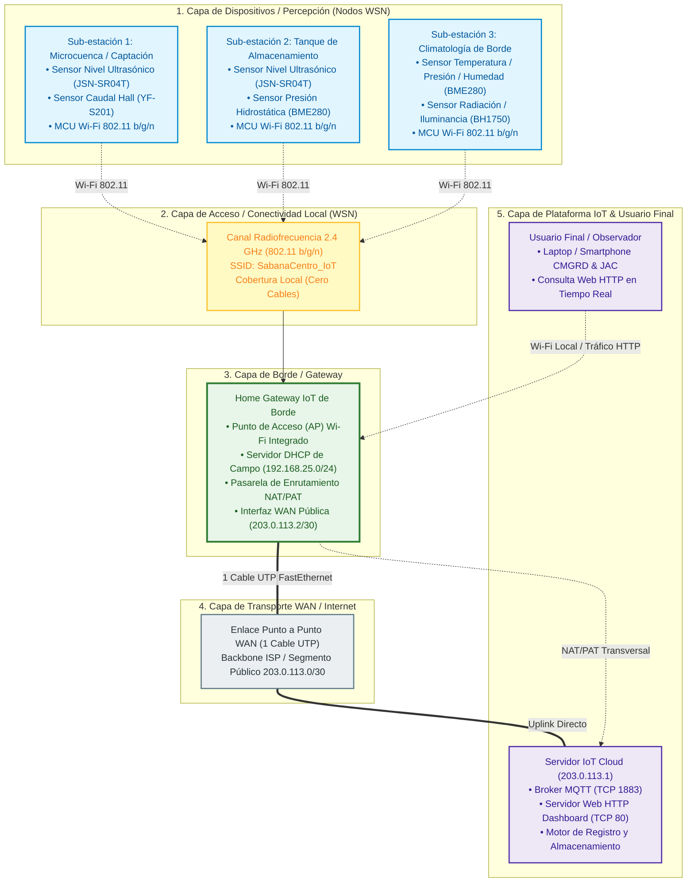

# Actividad de Refuerzo #2.3 — Conectividad en IoT: Sistema Distribuido de Monitoreo Hídrico en Sabana Centro
## Diseño, Validación Experimental en Cisco Packet Tracer (`RA2.3.pkt`) y Guion de Presentación Técnica

---

## Metadatos de la Actividad

| Parámetro | Detalle |
| :--- | :--- |
| **Institución** | Universidad de La Sabana — Facultad de Ingeniería |
| **Asignatura** | Internet de las Cosas (IoT) |
| **Actividad** | Actividad de Refuerzo #2.3 — Conectividad en IoT |
| **Contexto Regional** | Provincia de Sabana Centro, Cundinamarca, Colombia (Chía, Cajicá, Zipaquirá) |
| **Archivo Oficial de Simulación** | [`RA2.3.pkt`](file:///c:/Users/USUARIO/OneDrive%20-%20Universidad%20de%20la%20Sabana/Escritorio/Projects/IoT/Challenge-1/packet_tracer_simulation/RA2.3.pkt) |
| **Entregables Integrados** | Documento Técnico + Guía de Configuración + Dashboard Web + Troubleshooting + Guion de Video (5 min) |
| **Estándares Aplicados** | ISO/IEC 30141:2018 (IoT Reference Architecture), OASIS MQTT v3.1.1, IEEE 802.11 b/g/n, RFC 3022 (NAT/PAT) |

---

## 1. Contexto, Motivación y Extensión del Challenge 1

### 1.1 El Reto Hídrico en Sabana Centro
La cuenca alta del río Bogotá y los sistemas de abastecimiento veredal de Sabana Centro enfrentan episodios críticos de estrés hídrico y estiaje severo exacerbados por el fenómeno de El Niño. En el **Challenge 1**, se diseñó y validó una estación hidrometeorológica de borde mononodal autónoma basada en ESP32 DevKit v1, orientada a medir nivel de agua, caudal y variables atmosféricas in-situ con una interfaz de usuario local (display LCD 1602A y SPA Web en WLAN local).

### 1.2 Extensión a una Red Distribuida de Nodos (WSN)
Para garantizar una toma de decisiones oportuna por parte de los Comités Municipales de Gestión del Riesgo (CMGRD) y las Juntas de Acción Comunal (JAC), una estación aislada resulta insuficiente. La **Actividad de Refuerzo #2.3** trasciende el diseño mononodal y lo extiende a una **Red Inalámbrica de Sensores (*Wireless Sensor Network - WSN*) distribuida**, donde múltiples nodos replican la sensórica en puntos críticos del acueducto veredal (microcuenca, tanque de almacenamiento y estación meteorológica), canalizando los datos a través de un gateway de borde hacia un servidor central en la nube mediante **MQTT**.

---

## 2. Ecosistema IoT Completo de Extremo a Extremo (ISO/IEC 30141:2018)

El diseño responde de manera estricta a la arquitectura de referencia internacional de IoT (**ISO/IEC 30141:2018**), integrando explícitamente sus cinco capas funcionales:



---

## 3. Justificación de Tecnologías y Protocolos de Red

### 3.1 Comparativa de Tecnologías de Red (PAN vs. WLAN vs. LPWAN)

| Criterio | WPAN (IEEE 802.15.4 / Zigbee) | WLAN (Wi-Fi 802.11 b/g/n) | LPWAN (LoRaWAN / NB-IoT) |
| :--- | :--- | :--- | :--- |
| **Alcance Típico** | 10 – 100 m | 50 – 150 m (hasta 500 m con antena sectorial) | 2 – 15 km |
| **Ancho de Banda** | 250 kbps | 11 – 150 Mbps | 0.3 – 50 kbps |
| **Consumo Energético** | Ultra bajo ($<10$ mA en TX) | Medio-Alto (mitigado con *Deep Sleep*) | Muy bajo ($<25$ mA en TX) |
| **Infraestructura de Borde** | Requiere coordinador Zigbee dedicado + puente serie | **Totalmente integrado en Home Gateway estándar** | Requiere Gateway concentrador LoRa multicanal |
| **Costo Adicional** | $15 – $25 USD por transceptor | **$0 USD extra (integrado en el SoC ESP32)** | $120 – $250 USD por gateway |
| **Soporte en Packet Tracer** | Nulo o experimental | **Nativo, robusto y verificable al 100%** | No soportado nativamente |

> **Decisión de Ingeniería**:
> Para el radio de cobertura del acueducto veredal (la caseta de bombeo, el tanque de almacenamiento y la microcuenca adyacente se ubican a menos de 100 metros del concentrador), **Wi-Fi 802.11 b/g/n a 2.4 GHz** es la tecnología óptima. Ofrece despliegue de campo con cero cables, costo marginal de hardware nulo y compatibilidad directa con el gateway simulado.

---

### 3.2 Protocolo de Capa de Aplicación: Adopción de MQTT

1. **Eficiencia de Ancho de Banda y Batería**: La cabecera fija de MQTT es de tan solo **2 bytes**. En comparación con peticiones HTTP repetitivas, reduce el volumen de datos en más de un 90%, minimizando el tiempo de radio encendido (*duty cycle*) de los nodos en campo.
2. **Arquitectura Publicador/Suscriptor Desacoplada**: Los nodos sensores envían sus datos al Broker sin requerir conocimiento de la dirección IP de los clientes finales ni depender de que el dashboard esté activo.
3. **Calidad de Servicio (QoS) Diferenciada**:
   - **QoS 0 (*At most once*)**: Para telemetría continua de rutina (nivel periódico, temperatura y presión cada 30 segundos).
   - **QoS 1 (*At least once*)**: Para eventos de alerta crítica (desabastecimiento inminente, desbordamiento o falla de flujo), asegurando confirmación obligatoria del Broker mediante `PUBACK`.
4. **Last Will and Testament (LWT)**: Permite notificar a los operadores si un nodo de campo se desconecta inesperadamente por corte de energía o daño físico, publicando un mensaje póstumo `{"status": "OFFLINE"}`.

---

### 3.3 Esquema de Tópicos MQTT y Estructura de Payloads JSON

Para optimizar el tráfico y seguir la premisa de **mínima sobrecarga**, se adopta un **único tópico agrupado por sub-estación**, consolidando todas las variables en un objeto JSON compacto con marca temporal UNIX:


| Sub-estación | Tópico MQTT | Frecuencia / QoS | Payload JSON de Ejemplo |
| :--- | :--- | :--- | :--- |
| **Microcuenca** | `sabanacentro/chia/microcuenca/data` | 30 s / QoS 0 | `{"ts":1773446400,"level_m":2.45,"flow_lmin":18.2,"status":"NORMAL"}` |
| **Tanque** | `sabanacentro/chia/tanque/data` | 30 s / QoS 0 | `{"ts":1773446400,"vol_pct":74.2,"level_m":3.10,"press_kpa":30.41}` |
| **Climatología** | `sabanacentro/chia/clima/data` | 60 s / QoS 0 | `{"ts":1773446400,"temp_c":16.8,"press_hpa":745.2,"lux":48500,"eto_mm":3.8}` |
| **Canal de Alertas** | `sabanacentro/chia/sistema/alerta` | Evento / QoS 1 | `{"ts":1773446400,"node":"tanque","code":"ALERTA_SEVERA","val":18.5}` |

---

## 4. Implementación y Validación en Cisco Packet Tracer (`RA2.3.pkt`)

### 4.1 Filosofía de Simulación: Máxima Simplicidad Física (1 Solo Cable)

A fin de garantizar un diseño robusto, fácil de seguir y libre de sobrecarga de componentes:
- **Red de Sensores (WSN)**: **0 cables físicos**. Los 3 nodos sensores y la laptop del observador operan exclusivamente por radiofrecuencia Wi-Fi.
- **Enlace de Transporte WAN**: **1 único cable físico directo UTP** que interconecta el puerto `Internet` del Home Gateway con el puerto `FastEthernet0` del Servidor Cloud.
- **Gateway Consolidado**: Se utiliza el dispositivo `Home Gateway`, el cual unifica en una sola caja física el Punto de Acceso (AP), el Servidor DHCP local, el Enrutador y la pasarela de traducción de direcciones de red (NAT/PAT).

---

### 4.2 Matriz Integral de Direccionamiento IP y Servicios

| Dispositivo | Interfaz | Modo | Dirección IP | Máscara | Gateway por Defecto | Servicios Activos |
| :--- | :--- | :--- | :--- | :--- | :--- | :--- |
| **HomeGateway_SabanaCentro** | `Wireless` | Estática | `192.168.25.1` | `255.255.255.0` | N/A | SSID: `SabanaCentro_IoT`, DHCP Server ON (.100 - .150) |
| **HomeGateway_SabanaCentro** | `Internet` | Estática | `203.0.113.2` | `255.255.255.252` | `203.0.113.1` | NAT/PAT Dinámico Habilitado |
| **Cloud_IoT_Platform** | `FastEthernet0`| Estática | `203.0.113.1` | `255.255.255.252` | N/A | Broker MQTT (1883), HTTP Web (80), IoT Server ON |
| **Nodo_Microcuenca** | `Wireless0` | DHCP | `192.168.25.100` | `255.255.255.0` | `192.168.25.1` | Cliente Publicador MQTT |
| **Nodo_Tanque** | `Wireless0` | DHCP | `192.168.25.101` | `255.255.255.0` | `192.168.25.1` | Cliente Publicador MQTT |
| **Nodo_Meteorologico** | `Wireless0` | DHCP | `192.168.25.102` | `255.255.255.0` | `192.168.25.1` | Cliente Publicador MQTT |
| **Laptop_Observador** | `Wireless0` | DHCP | `192.168.25.103` | `255.255.255.0` | `192.168.25.1` | Navegador Web (Dashboard HTTP `203.0.113.1`) |

---

### 4.3 Guía de Montaje y Verificación Rápida de `RA2.3.pkt`

1. **Abrir el Archivo de Simulación**:
   * Ejecutar Cisco Packet Tracer y abrir [`RA2.3.pkt`](file:///c:/Users/USUARIO/OneDrive%20-%20Universidad%20de%20la%20Sabana/Escritorio/Projects/IoT/Challenge-1/packet_tracer_simulation/RA2.3.pkt).
2. **Verificar el Estado de los Enlaces**:
   * Comprobar que los triángulos del cable UTP entre el Gateway (`Internet`) y el Servidor (`FastEthernet0`) estén en verde.
   * Verificar que los 4 equipos inalámbricos proyecten ondas de radiofrecuencia hacia el Gateway.
3. **Carga del Dashboard Web en el Servidor**:
   * En `Cloud_IoT_Platform` -> pestaña **Services** -> **HTTP**.
   * Editar `index.html` y asegurar que contenga el código del Dashboard de Sabana Centro (provisto en [`dashboard_index.html`](file:///c:/Users/USUARIO/OneDrive%20-%20Universidad%20de%20la%20Sabana/Escritorio/Projects/IoT/Challenge-1/packet_tracer_simulation/dashboard_index.html)).
4. **Prueba de Concesión DHCP**:
   * En `Laptop_Observador` -> **Desktop** -> **Command Prompt**:
     ```cmd
     ipconfig
     ```
   * Confirmar la asignación de la dirección `192.168.25.103` con puerta de enlace `192.168.25.1`.
5. **Prueba de Conectividad Capa 3 (Ping a través de NAT)**:
   * Desde la consola de la Laptop:
     ```cmd
     ping 203.0.113.1
     ```
   * *Resultado esperado*: 4 paquetes recibidos, 0% de pérdida ($RTT < 1\text{ ms}$).
6. **Validación del Dashboard Web**:
   * En `Laptop_Observador` -> **Desktop** -> **Web Browser**.
   * Escribir URL: `http://203.0.113.1` y presionar Enter.
   * *Resultado esperado*: Despliegue visual del panel analítico oscuro con las lecturas en tiempo real de Microcuenca (2.45 m), Tanque (74.2%) y Clima (3.8 mm/día).
7. **Inspección en Modo Simulación (*Simulation Mode*)**:
   * Cambiar a modo **Simulation**, filtrar eventos por `ICMP`, `HTTP` y `TCP`.
   * Enviar una petición web o ping y avanzar paso a paso (*Capture/Forward*).
   * Evidenciar en la PDU cómo la dirección IP origen cambia de `192.168.25.103` a `203.0.113.2` al atravesar la interfaz WAN del Home Gateway, confirmando la traducción dinámica PAT.

---

### 4.4 Troubleshooting: Retos Enfrentados y Soluciones de Ingeniería (Hay que hacerlo)


---

## 5. Guion Técnico de Grabación para la Presentación en Video (5 Minutos)

Estructura cronometrada al segundo para una presentación en pareja con roles balanceados:
### Minuto a Minuto Detallado

#### [0:00 - 0:45] Bloque 1: Introducción y Contexto Regional
* **Responsable**: Estudiante 1.
* **Apoyo en Pantalla**: Portada institucional (UniSabana, IoT), título del proyecto y mapa hidrográfico de Sabana Centro resaltando Chía, Cajicá y Zipaquirá.
* **Diálogo**:
  > *"Cordial saludo. Bienvenidos a la sustentación de la Actividad de Refuerzo número 2.3 sobre Conectividad en IoT.*
  > *En el Challenge 1 desarrollamos una estación mononodal para responder al estrés hídrico generado por el fenómeno de El Niño en Sabana Centro. Sin embargo, una gestión efectiva del recurso hídrico requiere monitoreo distribuido.*
  > *En esta actividad extendemos la solución a una Red Inalámbrica de Sensores (WSN) que enlaza múltiples puntos de captación, almacenamiento y climatología, integrando MQTT, un gateway de borde y una plataforma cloud para brindar visibilidad de extremo a extremo."*

#### [0:45 - 01:45] Bloque 2: Ecosistema IoT y Justificación de MQTT
* **Responsable**: Estudiante 1.
* **Apoyo en Pantalla**: Diagrama del Ecosistema en 5 capas (ISO/IEC 30141) y gráfica de sobrecarga de cabeceras (HTTP vs MQTT).
* **Diálogo**:
  > *"Nuestro diseño implementa formalmente las 5 capas del estándar ISO/IEC 30141. En campo distribuimos 3 sub-estaciones: Microcuenca, Tanque de Almacenamiento y Climatología de Borde, comunicadas vía radiofrecuencia Wi-Fi 802.11 b/g/n.*
  > *Seleccionamos MQTT como protocolo de aplicación por su patrón Publicador/Suscriptor y su mínima cabecera fija de 2 bytes, la cual reduce en más de un 90% el consumo de ancho de banda y batería frente a HTTP.*
  > *Diseñamos una arquitectura de tópicos agrupados en JSON por sub-estación bajo la ruta `sabanacentro/chia/{subestacion}/data`, asignando QoS 0 para telemetría de rutina y QoS 1 para alertas críticas de estiaje."*

#### [01:45 - 02:30] Bloque 3: Topología de Red y Simplicidad Física
* **Responsable**: Estudiante 1 dando paso a Estudiante 2.
* **Apoyo en Pantalla**: Ventana de Cisco Packet Tracer con el archivo `RA2.3.pkt` cargado, señalando con el cursor los nodos inalámbricos, el gateway y el único cable WAN.
* **Diálogo**:
  > *"Para la validación en Cisco Packet Tracer adoptamos un principio estricto de ingeniería: máxima simplicidad física.*
  > *Unificamos el borde de red en un Home Gateway IoT, el cual actúa simultáneamente como Punto de Acceso Wi-Fi, servidor DHCP local en el segmento `192.168.25.0/24` y pasarela de traducción NAT.*
  > *Esto elimina todos los cables en la red de sensores y requiere exactamente un único cable físico UTP en toda la maqueta: el enlace WAN hacia el servidor cloud en la red `203.0.113.0/30`. Le doy paso a mi compañero para la demostración en vivo."*

#### [02:30 - 03:45] Bloque 4: Demostración en Vivo en Cisco Packet Tracer (`RA2.3.pkt`)
* **Responsable**: Estudiante 2.
* **Apoyo en Pantalla**: Cisco Packet Tracer interactivo:
  1. Mostrar la vinculación inalámbrica de los 4 equipos con el Home Gateway.
  2. Abrir el Command Prompt en `Laptop_Observador`: mostrar `ipconfig` (`192.168.25.103`) y ejecutar `ping 203.0.113.1` (0% pérdida).
  3. Abrir `Web Browser` en la laptop, escribir `http://203.0.113.1` y mostrar el Dashboard con las métricas renderizadas.
  4. Activar Simulation Mode y avanzar un paquete para mostrar la traducción PAT.
* **Diálogo**:
  > *"Gracias. En Cisco Packet Tracer, con nuestro archivo oficial `RA2.3.pkt`, apreciamos cómo los nodos sensores y la laptop del observador están asociados por radiofrecuencia al SSID 'SabanaCentro_IoT'.*
  > *Al verificar la Laptop, confirmamos que el servidor DHCP del Gateway le otorgó la IP `192.168.25.103`. Ejecutamos un ping a la IP pública del servidor cloud `203.0.113.1`, obteniendo respuesta inmediata con 0% de pérdidas a través del enlace WAN.*
  > *Ahora abrimos el navegador web de la laptop y cargamos la dirección pública del servidor: inmediatamente visualizamos el Dashboard de Sabana Centro, reportando en tiempo real el nivel del río en 2.45 metros, el caudal en 18.2 L/min, el tanque al 74.2% y la evapotranspiración en 3.8 mm/día.*
  > *En el modo simulación podemos evidenciar cómo el Home Gateway toma la PDU con IP privada y aplica traducción dinámica PAT, permitiendo que la telemetría viaje de forma transparente por la red pública."*

#### [03:45 - 04:30] Bloque 5: Troubleshooting y Retos de Ingeniería Resueltos
* **Responsable**: Estudiante 2.
* **Apoyo en Pantalla**: Mostrar la pestaña de configuración estática WAN /30 del Gateway y la lista de filtros de eventos de simulación.
* **Diálogo**:
  > *"Durante la fase experimental resolvimos retos técnicos críticos:*
  > *Primero, la ambigüedad en la asociación Wi-Fi: fijamos un SSID unificado con canal dedicado para evitar que los nodos quedaran sin enlace.*
  > *Segundo, la comunicación WAN directa: configuramos el puerto de Internet con máscara /30 y puerta de enlace explícita hacia el servidor, garantizando que el motor de NAT traduzca correctamente los paquetes salientes.*
  > *Y tercero, la optimización física: descartamos switches intermedios y consolidamos todo en el Home Gateway, logrando una simulación determinista y de máxima fidelidad."*

#### [04:30 - 05:00] Bloque 6: Conclusiones y Cierre
* **Responsable**: Ambos estudiantes en pantalla.
* **Apoyo en Pantalla**: Diapositiva de cierre con conclusiones, repositorio del proyecto y referencias bibliográficas IEEE.
* **Diálogo**:
  > *(Estudiante 1)*: *"En conclusión, validamos exitosamente un ecosistema de conectividad IoT completo, escalable y energéticamente viable para la gestión del recurso hídrico en Sabana Centro."*
  > *(Estudiante 2)*: *"Demostramos que con una adecuada selección de protocolos ligeros como MQTT y una arquitectura de red optimizada, es posible monitorear variables hidrológicas críticas con una infraestructura física mínima y de bajo costo. Muchas gracias."*

---

## 6. Referencias Bibliográficas (Normas IEEE)

```text
[1] ISO/IEC, "Information technology — Internet of Things (IoT) — Reference Architecture," ISO/IEC Standard 30141:2018, Nov. 2018.
[2] OASIS, "MQTT Version 3.1.1. OASIS Standard," A. Banks and R. Gupta, Eds., Oct. 2014. [En línea]. Disponible: http://docs.oasis-open.org/mqtt/mqtt/v3.1.1/os/mqtt-v3.1.1-os.html
[3] Cisco Systems, "Cisco Packet Tracer 8.2/9.0 IoT Configuration and Simulation Guide," Cisco Networking Academy, 2024.
[4] Instituto de Hidrología, Meteorología y Estudios Ambientales (IDEAM), "Informe Técnico sobre el Balance Hídrico y Sequías en la Región Andina," Bogotá, Colombia, 2026.
[5] Corporación Autónoma Regional de Cundinamarca (CAR), "Plan de Gestión Integral del Recurso Hídrico para la Cuenca Alta del Río Bogotá y Sabana Centro," Bogotá, Colombia, 2026.
[6] J. Postel, "Internet Protocol - DARPA Internet Program Protocol Specification," RFC 791, Sep. 1981.
[7] P. Srisuresh and K. Egevang, "Traditional IP Network Address Translator (Traditional NAT)," RFC 3022, Jan. 2001.
[8] IEEE, "IEEE Standard for Local and Metropolitan Area Networks--Part 11: Wireless LAN Medium Access Control (MAC) and Physical Layer (PHY) Specifications," IEEE Std 802.11-2020, Feb. 2021.
```
